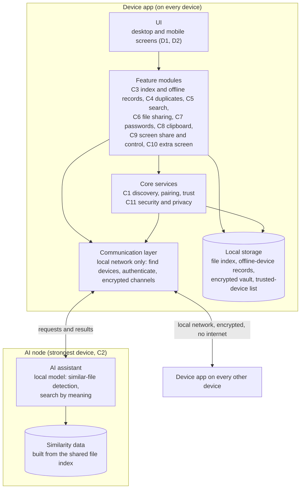

# B1: System architecture (v0, draft)

Owner: Mahmoud. Status: v0, 11 Oct 2026. Final due Wed 21 Oct (v1 for milestone M1, Thu 22 Oct).
Purpose of v0: give everyone the same picture of the parts so the feature designs (C1-C11) can start on 18 Oct. It names the parts and what each one is responsible for. It does **not** choose technologies: that is B6 (Ali). Anything marked *open* below waits for B6 or for the professor.

## The idea in one sentence
Every device runs the same device app. The apps find each other on the local network and talk directly (peer to peer, no internet, no cloud server). One device, the strongest, also runs the AI assistant.

## Diagram

## Parts and responsibilities

| Part | Responsibility | Designed in |
|---|---|---|
| UI | Screens on desktop and phone; talks only to the feature modules | D1, D2 |
| Feature modules | One module per feature; each uses core services, local storage and the communication layer, never the network directly | C3-C10 |
| Core services | Discovery, pairing and trust between devices; encryption, permissions, protection if a device is lost. Every feature depends on these | C1, C11 |
| Communication layer | Finds devices on the local network, authenticates them, opens encrypted channels, moves messages and files | C1, B6 (library) |
| Local storage | Each device keeps its own file index, its copy of the last known state of offline devices, the encrypted vault (if C7 stays in scope) and the trusted-device list | B5, C3 |
| AI node | Runs on the strongest device. Takes the shared file index, finds similar files and answers searches by meaning. Exact duplicates (by hash) do **not** need it | C2, C4, C5 |

## How the parts work together (two examples)
1. **A new device joins:** the UI asks the user to pair; core services run discovery and trust (C1) over the communication layer; the trusted-device list is saved in local storage.
2. **Find duplicates:** each device indexes its own files (C3) and stores the index; indexes are shared over the communication layer; exact copies are matched by hash on any device; similar photos and videos are sent to the AI node (C2); the result goes back to the UI (C4).

## Rules this architecture sets for the other designs
- No cloud and no internet: everything stays on the user's local network.
- Every device keeps working alone (own files, own index) when others are off; offline devices appear from their last known record (C3).
- If the AI node is off, exact-duplicate detection and file sharing still work; only the AI features pause. What happens then is designed in C2.
- Feature designs use the names above (device app, communication layer, AI node, local storage) so the diagrams (B2, B3, B4) match.

## Open (waiting)
- **Platforms** (iOS, Android, Windows, Linux) and file formats: asked to the professor; B6 and C10 depend on it.
- **Scope** of C7 (passwords), C9 (screen share and control), C10 (extra screen): asked to the professor. If any is dropped, remove its module from the diagram.
- **Technology choices** (languages, communication library, AI model and how it runs): B6 (Ali). B1 and B6 must agree by Thu 22 Oct.
- **Which device is the AI node** and what happens if it changes: C2 (Mohammed).
