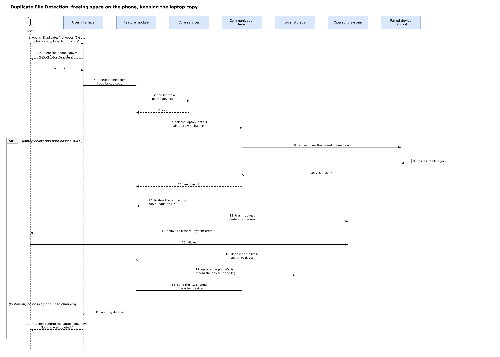

# Duplicate File Detection

## Introduction

The same photos, videos and documents often end up on several of a user's devices, and on one device more than once. They take storage space without the user knowing. Duplicate File Detection finds these copies across all of the user's paired devices and shows them in one place, with the space that can be freed. It finds three kinds of copies: exact copies with the same content, the same photo saved in another size, and similar photos and videos, such as several shots of the same moment. The user decides what to keep. A file is deleted only by the device that holds it, after the user confirms, and only when the copy being kept has just been confirmed to exist, so the last copy of a file is never deleted. This section describes how copies are found, how they are shown, which copy the app suggests keeping, how deletion works, and what is stored.

## 1. How it works

Every device reads only its own files. Every device also holds a copy of the file lists of the user's other devices, from File Indexing and Offline-Device Records. From these lists any device can find exact copies and copies of the same photo in another size. The AI device adds a third kind, similar photos and videos, from small previews. The user sees the groups on any device and chooses what to keep.

## 2. Exact copies

- **What counts as an exact copy.** Two files are exact copies when they have the same size and the same SHA-256 fingerprint of their whole content, whatever their names, folders or dates.
- **Three steps, cheapest first.** The open-source duplicate finder Czkawka uses the same order, so that most files never need a full fingerprint.
  1. **Size.** The sizes come from the file lists, so no file is read. A size that occurs only once across all devices cannot belong to a copy.
  2. **Partial fingerprint.** The owner device computes the SHA-256 fingerprint of the first 4 KB, the last 4 KB and the size, only for files whose size occurs more than once.
  3. **Full fingerprint.** The owner device computes the SHA-256 fingerprint of the whole file, only for files that still match. Equal full fingerprints mean an exact copy.
- **Fingerprints are kept.** Each fingerprint is stored with the path, size and modified date of its file, so an unchanged file is never read twice. The full fingerprint is computed only when it is needed, because reading every byte of every file on every device would take hours of disk work and battery.
- **When the work is done.** Computers and laptops work in the background. Android works while the app is open or while its "Stay connected" mode is on. iPhone and iPad work only while the app is open.
- **Files that are left out.** Files under 64 KB (the user can change this limit), system and app folders, files that the system does not let the app read, and files that exist only in a cloud service. For example, an iPhone photo kept only in iCloud would need the internet to be read, so it is shown as "Not on this device" and is left out of the comparison.
- **Devices that are switched off.** The size step works from the stored lists alone. The two fingerprint steps use the fingerprints that a device computed before it was switched off. If a new file now matches a size that was unique at that time, the group is shown as "Possible copy, check when *Laptop-1* is back", and it is confirmed when that device reconnects.

## 3. The same photo in another size, and similar photos and videos

| | **Same photo, other size** | **Similar photos** |
|---|---|---|
| What it finds | Resized, re-saved or re-compressed copies, for example a photo sent through a chat app | Several shots of the same moment, small edits and crops |
| Method | A perceptual fingerprint (Gradient method, 16 × 16 = 256 bits, 32 bytes for each photo) | A CLIP ViT-B/32 image vector of 512 numbers |
| Who computes it | The owner device, while it indexes the photo | The AI device, from a preview |
| When two photos match | The fingerprints differ in 5 bits or fewer, and the photos have the same shape (width-to-height ratio within 2 %) | A similarity of 0.90 or more |
| Needs the AI device | No | Yes |

- **Previews for the AI device.** The owner device sends one JPEG preview of 224 × 224 pixels over the encrypted connection between paired devices. The short side of the photo is resized to 224 pixels and the centre is cut out, which is exactly the model's own input step. The AI device makes the vector and then deletes the preview. It keeps only the vector and the file's fingerprint, and it sends nothing back to other devices except the groups. A first build takes an estimated 2 hours for 100,000 photos on a 4-core, 8-thread laptop-class processor, plus the time to make and send the previews and to process videos. After that, only new photos are processed.
- **Comparing.** A new photo is compared with all stored vectors, which is a small amount of work (100,000 × 512 multiplications). A full rebuild compares all pairs as one matrix product in blocks: 100,000² ÷ 2 × 512, about 2.6 × 10¹² multiply-adds, an estimated few minutes on a laptop with ONNX Runtime.
- **Groups.** Each group is built around one photo. Another photo joins only if it is similar to that photo, which avoids long chains in which A looks like B and B looks like C, but A does not look like C.
- **Avoiding false groups.** Perceptual fingerprints ignore colour, so a black-and-white copy matches its colour original, and plain backgrounds match each other. The "same photo" group therefore also requires the same shape, and similar groups are never deleted in bulk (section 5).
- **Videos.** Exact copies of videos are found by fingerprint, like any other file. For similar videos, the owner device sends 3 frames, taken at 10 %, 50 % and 90 % of the video's length, as 224 × 224 previews. Two videos are similar when their lengths differ by 2 seconds or less and all three pairs of frames reach the photo threshold. If a phone cannot take frames from videos, that phone offers exact video copies only.
- **When the AI device is off.** Exact copies and "same photo" groups keep working. The "Similar" tab shows the last results and their date, as described in AI Analysis.

## 4. What the user sees

- **Three tabs:** "Exact copies", "Same photo, other size" and "Similar". Each group is labelled "On one device" (usually wasted space) or "On several devices" (possibly a backup).
- **Each file** shows its device name and kind, folder, size, date, resolution (for photos) and a preview. The preview comes from the file if it is on this device. It is requested from the other device if that device is online, and it is not kept. A device that is switched off shows no preview and a note such as "Laptop is off, record from 28 Oct".
- **At the top,** the screen shows the space that can be freed, for each device and in total.
- **For each group** the user can choose "Keep suggested", "Choose what to delete" or "Ignore this group". An ignored group is remembered (section 6). A bulk action is offered only for exact copies on one device, never for similar photos.

## 5. Which copy is kept, and who deletes

**Which copy the app suggests keeping:**
- **Exact copies on one device:** keep one copy. The app prefers a copy in the user's main folders (Pictures, Documents) over Downloads, temporary folders and chat-app folders; then the oldest modified date, which is probably the original; then the shortest path.
- **Exact copies on several devices:** keep all copies by default, with the note "This may be your backup". The app offers "Free space on *Phone-1*", which deletes the copies on that device only where a copy stays on another device. It suggests the device with the least free space.
- **The same photo in another size, and similar photos:** nothing is selected in advance. A star marks the best copy (the highest resolution, then the largest file, then the newest), and the user ticks what to delete.

**Who deletes and how.** Only the device that holds a file deletes it, after the user has confirmed on any device. The file is moved to the system's trash or recycle bin where there is one, not deleted for good.
- **Android 11 and later:** photos and videos are moved to the trash through the system's own trash request, which shows its own prompt from the app's screen; trashed items are usually kept for 30 days. Other files on Android, and all files on Android 7 to 10 (which have no trash), are deleted directly with the "All files access" permission, so the app first asks once more, in its own words, that the deletion cannot be undone.
- **iPhone and iPad:** photos are deleted through the photo library.
- **Phones in general:** a deletion on a phone runs only while the user has the app open there.

**Checks before every deletion.** The owner device first fingerprints its file again and stops if the file has changed. It then confirms that the copy being kept still exists with the same fingerprint: on the same device by reading it, and on another device by asking that device at that moment over the encrypted connection. If the other device does not answer, nothing is deleted. The last copy of a file is therefore never deleted.

**When the owner device is off or nobody is there.** The request waits and is shown as "Waiting for *Laptop-1*". Each device has a switch, "Allow my other devices to delete duplicates here", which is off by default. When it is on, a computer or laptop runs a waiting request within 7 days, after the checks pass, and shows a notice. Phones still need their user, as described above. When the switch is off, or the request is older than 7 days, the owner device asks its own user. Every device keeps a deletion log for 30 days, recording what was deleted, when, at the request of which device, and which copy was kept.

## 6. What is stored

- **In the file lists, on every device:** two new fields, a partial fingerprint (32 bytes, only for possible copies) and a perceptual fingerprint (32 bytes, photos only). The existing fingerprint field holds the full SHA-256 fingerprint and is filled only when it is needed. This adds at most 64 bytes for each file, an estimated 6.4 MB for 100,000 files.
- **Groups:** exact and "same photo" groups are computed on each device from its own copy of the lists, so nothing extra is sent. Similar groups are sent by the AI device as small messages and are kept with their date.
- **The list of ignored groups:** each ignored group is stored as the fingerprints of its members and is shared with all devices, so a group ignored on one device is ignored everywhere.
- **Vectors:** they stay on the AI device only, 2 KB for each photo, about 200 MB for 100,000 photos, or half that with 16-bit numbers.
- **Updating:** when list changes arrive, only the sizes and photos that changed are checked again. A new AI device builds the vectors again. When a device is removed, its files leave every group as soon as its list is deleted.

## 7. Freeing space on the phone while keeping the laptop copy

**Figure: freeing space on the phone while keeping the laptop copy.** Source file: `diagrams/C4-duplicate-sequence.drawio`.

The example uses an Android phone. The user chooses to delete the phone copy and keep the laptop copy, and confirms. The phone asks the laptop, over the paired connection, whether the copy to keep still exists with fingerprint H (steps 5 to 9). The phone sends the trash request only if the laptop answers yes and the phone's own copy still has fingerprint H. Android then shows its own prompt (steps 10 to 14). The phone updates its list, records the deletion in the log and sends the change to the other devices. Otherwise nothing is deleted, and the user sees "Cannot confirm the laptop copy now. Nothing was deleted." (step 17). On a computer, step 11 moves the file to the recycle bin or trash, and steps 12 and 13 do not happen. The laptop's own internal steps are shown inside the single "Paired device" lane. On an iPhone or iPad, the photo library deletes the photo.

## 8. Requirements

- FR-DUP-1 The app must treat files with the same size and the same SHA-256 fingerprint as exact copies, and only the device that holds a file may read it.
- FR-DUP-2 The app must compute a full fingerprint only for files that match another file in size and in partial fingerprint.
- FR-DUP-3 The app must find resized copies of a photo with a perceptual fingerprint, without the AI device.
- FR-DUP-4 The app must find similar photos on the AI device from previews that the AI device deletes after use.
- FR-DUP-5 The app must show groups as exact, same photo or similar, and as on one device or on several devices, with the space that can be freed.
- FR-DUP-6 The app must delete a file only on the device that holds it, and only after the user has confirmed, the file has been fingerprinted again and the kept copy has been found to still exist.
- FR-DUP-7 For a deletion requested by another device, the app must also require that the owner device has turned on "Allow my other devices to delete duplicates here" (off by default) or that the user confirms on the owner device.
- FR-DUP-8 The app must never delete the last copy of a file, and it must record every deletion in a log kept for 30 days on the owner device.
- FR-DUP-9 The app must move deleted files to the system's trash or recycle bin where the system has one.
- FR-DUP-10 The app must not show an ignored group again on any device.
- NFR-DUP-1 The app must find exact copies with no other device online, from the last lists, and must show a match that still needs a missing fingerprint as "possible" until the device returns.
- NFR-DUP-2 The app must not let any file content leave its device, except previews for the AI device, which are not stored.
- NFR-DUP-3 The app must complete a first AI build of 100,000 photos in about 2 hours of model time on a 4-core, 8-thread laptop-class processor, without the previews and the videos.

## 9. Limitations

The thresholds of 5 bits and 0.90 are starting values that will be tuned on the team's own photos. The following has not yet been verified: the first build time with ONNX Runtime (the figure comes from a published measurement of the same image model on an Intel i7-8559U processor, at 14.8 previews per second); how frames are taken from videos on each system; the delete prompt on iPhone and iPad; whether the `MANAGE_MEDIA` permission (Android 12 and later) skips Android's own prompt; how the app detects photos that are kept only in iCloud; and access to the recycle bin from Flutter on computers. iPhone, iPad and macOS cannot be built or tested by the team, because no member has a Mac.

## 10. Summary

Duplicate File Detection shows the user where the same files take space twice, across all of their devices. Exact copies are found cheaply from the file lists, by size first and then by fingerprint, and resized photos are found without the AI device. The AI device adds similar photos and videos from small previews that it does not keep. The app suggests what to keep but never decides alone: copies on several devices are kept by default, every deletion is checked again, and the last copy of a file is never deleted.

## References (opened 31 October and 8 November 2026)

1. Czkawka documentation (size, partial and full fingerprint steps; perceptual fingerprint methods and thresholds; greyscale matches; similar videos with ffmpeg): https://github.com/qarmin/czkawka/tree/master/instructions
2. Android, `MediaStore.java` (`createTrashRequest`, `IS_TRASHED`, "default trashed expiration is typically 30 days"), AOSP mirror: https://github.com/aosp-mirror/platform_packages_providers_mediaprovider/blob/main/apex/framework/java/android/provider/MediaStore.java
3. Android, API 30 differences for `MediaStore` (both requests added in API 30): https://developer.android.com/sdk/api_diff/30/changes/android.provider.MediaStore
4. Apple, `PHAssetChangeRequest.deleteAssets(_:)`: https://developer.apple.com/documentation/photos/phassetchangerequest/deleteassets(_:)
5. OpenAI CLIP, `clip/clip.py` (resize to the input size, then centre crop): https://github.com/openai/CLIP/blob/main/clip/clip.py
6. Mustafa.net, "Immich without a GPU" (measured on 10 October 2026): https://mustafa.net/2026/10/10/immich-without-gpu-intel-nuc/
7. Team documents: Technology Choices (final); AI Analysis; File Indexing and Offline-Device Records; Security and Privacy; Implementation and Evaluation Plan.
