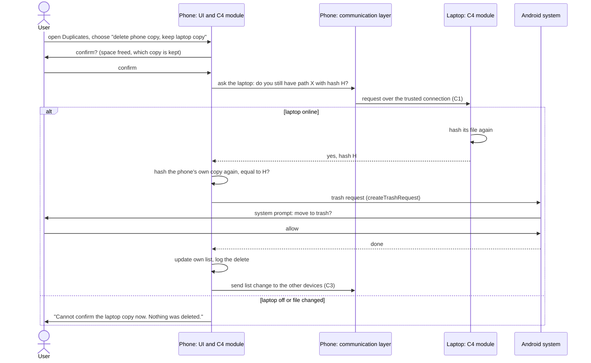

# C4: Duplicate-file detection (first version)

Owner: Ali. Status: first version, 31 Oct 2026 (was due Fri 30 Oct; final Mon 2 Nov). Answers the questions in `C4-duplicate-detection-questions.md` (numbers in brackets, Q1 to Q18) and B1 decision 9 [5]. Phase 1 is design only: no code. Names follow `B1-architecture-v2.md`; technology from `B6-technology-final.md`.
**[PROPOSAL]** = a design choice or number to tune in Phase 2. **[NOT CHECKED]** = not confirmed in a primary source or by a test.

## 1. How it works in one paragraph
Every device reads only **its own** files. From the shared file lists (C2) any device can find exact copies in three steps (same size, same partial hash, same full hash) and resized copies of a photo (close perceptual hashes). The AI device adds a third kind, "similar photos", from CLIP vectors made from small previews. The user sees the groups on any device, picks what to keep, and each file is deleted only by the device that owns it, after it checks that the copy being kept still exists.

## 2. Exact copies (Q1 to Q4)
- **Definition:** same size and same SHA-256 of the whole content, whatever the name, folder or date [Q1].
- **Three steps, cheapest first [Q2]** (the same pipeline the open-source duplicate finder Czkawka uses: size, then a "prehash" over a small chunk from the start and the end, then a full hash, so most files never need a full hash [1]):
  1. **Size**, from the shared lists, no file reading. A size found only once across all devices cannot have a copy.
  2. **Partial hash**: SHA-256 of the first 4 KB + last 4 KB + the size [PROPOSAL, chunk size as Czkawka's cache [1]], computed by the owning device only for files whose size occurs more than once.
  3. **Full SHA-256**, by the owning device, only for files that still match. Equal full hash = exact copy.
- Each hash is cached with (path, size, modified date), so an unchanged file is never read twice. **Change for C2:** the hash field is filled only when step 3 needs it, not for every file; reading every byte on every device (for example 500 GB on a PC) would cost hours of disk and battery [NOT CHECKED, not measured]. Mohammed to agree.
- **When:** desktops and laptops in the background; Android while the app is open or the "stay connected" mode is on; iPhone/iPad only while the app is open (B6 choice 6) [Q2].
- **Left out [Q3]:** files under 64 KB [PROPOSAL, the user can change it]; system and app folders (the indexing scope is C3's); files the system does not let us read; files that are only in the cloud. For iPhone photos stored only in iCloud ("Optimize iPhone Storage"), reading the original would need the internet: they are shown as "not on this device" and skipped [NOT CHECKED: how the app detects this].
- **Off devices [Q4]:** steps 1 to 3 use the stored lists, so copies on a switched-off device are found from its last record, marked with its date (C3).

## 3. Similar photos and videos (Q5 to Q8)
Two methods, for two kinds of "similar" [Q5]:

| | **Same photo, other size** | **Similar photos** |
|---|---|---|
| Finds | resized, re-saved, re-compressed copies (e.g. sent by a chat app) | burst shots, small edits and crops, same scene |
| Method | perceptual hash: Gradient, size 16 (16×16 = 256 bits, 32 bytes) per photo [PROPOSAL; Czkawka's suggested starting point: Gradient, size 16, max difference 5 [1]] | CLIP ViT-B/32 image vector, 512 numbers (B6 choice 4) |
| Who computes | the owning device, while it indexes the photo | the AI device, from a preview |
| Match | Hamming distance ≤ 5 [PROPOSAL] | cosine similarity ≥ 0.90 [PROPOSAL, tune on our own photos] |
| Needs the AI device | no | yes |

- **Previews for the AI device [Q6]** (B1 decision 14): the owning device sends one JPEG preview (short side 256 px [PROPOSAL]) over the trusted connection; the AI device makes the vector and deletes the preview. It keeps only the vector and the file's hash; nothing goes back to other devices except the groups. Cost: about 2 hours per 100,000 photos on a 4-core laptop, then only new photos (B6 point 2, estimate).
- **Comparing:** a new photo is compared with all stored vectors (100,000 × 512 multiplications, very small). A full rebuild compares all pairs as a matrix product in blocks: 100,000² ÷ 2 × 512 ≈ 2.6 × 10¹² multiply-adds, minutes on a laptop if run in ONNX Runtime [estimate, NOT CHECKED].
- **Groups:** built around one photo; a photo joins only if it is similar to that photo, which avoids long chains of "A looks like B looks like C" [PROPOSAL].
- **False groups [Q7]:** perceptual hashes ignore colour, so a black-and-white copy matches its colour original, and plain backgrounds match each other [1]. So the "same photo" group also needs equal aspect ratio (±2 %) [PROPOSAL], and "similar" groups are never deleted in bulk (section 5).
- **Videos [Q8]:** exact copies by hash, as any file. Similar videos: the owning device sends 3 frames (at 10 %, 50 % and 90 % of the length) as previews; two videos are similar if their lengths differ by 2 s or less and all three frame pairs pass the photo threshold [PROPOSAL]. Czkawka also samples frames and needs ffmpeg for it [1]; how our app takes frames on each system is [NOT CHECKED]. If it fails on phones, phones offer exact video copies only.
- **AI device off [Q8]:** exact copies and "same photo" groups keep working; "similar" shows the last results and their date, as C2 designs.

## 4. Showing the results (Q9 to Q11)
- Three tabs: **Exact copies**, **Same photo, other size**, **Similar**. Each group is labelled **On one device** (usually waste) or **On several devices** (may be a backup) [Q9].
- Each file: device name and kind, folder, size, date, resolution (photos), and a preview: from the file if it is on this device; requested from its device if online (not kept); none if the device is off ("Laptop is off, record from 28 Oct") [Q10].
- At the top: space that can be freed, per device and in total. Per group: **Keep suggested**, **Choose what to delete**, **Ignore this group** (remembered, section 6). Bulk action only for exact copies on one device; never for "similar" [Q11].

## 5. Which copy is kept, and who deletes (Q12 to Q15, decision 9)
**Recommendation [Q12]:**
- *Exact, on one device:* suggest keeping one copy: first in the user's main folders (Pictures, Documents) over Downloads, temporary and chat-app folders; then the oldest modified date (likely the original); then the shortest path.
- *Exact, on several devices:* suggest **keeping all** by default ("this may be your backup"). Offer "Free space on *device*": delete the copies on that device only where a copy stays on another device. Suggest the device with the least free space (needs free space in the device record, C3).
- *Same photo / similar:* nothing is pre-selected. A star marks the best copy (highest resolution, then largest file, then newest), and the user ticks what to delete.

**Who and how [Q13]:** only the device that **owns** the file deletes it, after the user confirmed (on any device). The file goes to the system's trash where there is one, not deleted for good [NOT CHECKED: trash access from Flutter on desktops]. On Android 11+ the app asks the system (`createTrashRequest`), which shows its own prompt; trashed items are kept typically 30 days [2][3]. On iPhone/iPad, photos are deleted through PhotoKit [4]; whether iOS shows its own prompt is [NOT CHECKED]. So deletes on a phone run when the user has the app open there.

**Safety checks before every delete [Q14]:** the owning device (1) hashes its file again and stops if it changed; (2) confirms that the copy being kept still exists with the same hash: on the same device by reading it, on another device by asking that device now, over the trusted connection. If the other device does not answer, nothing is deleted: **the last copy is never deleted**.

**Owner off or nobody there [Q15]:** the request waits as "Waiting for Laptop". Each device has a switch, **"My other devices may delete duplicates here"**, off by default (permission for C11). If it is on, the owner runs a waiting request within 7 days after the checks pass and shows a notice; if it is off, or the request is older, the owner asks its own user [PROPOSAL]. Every device keeps a deletion log for 30 days (what, when, asked by which device, which copy was kept) [PROPOSAL].

## 6. Storage (Q16 to Q18)
- **Index (on every device, for every device's files, C3):** + partial hash (32 bytes, candidates only), full hash (32 bytes, candidates only), perceptual hash (32 bytes, photos). At most about 100 bytes per file, so up to 10 MB per 100,000 files [estimate] [Q16].
- **Groups:** exact and "same photo" groups are computed on each device from its own copy of the lists, so nothing extra is sent. "Similar" groups are sent by the AI device as small messages and kept with their date. The **ignore list** (each group stored as its members' hashes) is shared with all devices, so "ignore" works everywhere. **Vectors** stay on the AI device only: 2 KB per photo, about 200 MB per 100,000 photos; half with 16-bit numbers [PROPOSAL] [Q17].
- **Recompute [Q18]:** when list changes arrive, only for the sizes and photos that changed. A new AI device rebuilds the vectors (C2). A removed device (C1): its files leave every group when its records are removed (C3 decides when).

## 7. Sequence: free space on the phone, keep the laptop copy
Draft in Mermaid; the final version (2 Nov) will be draw.io with a PNG export.

## 8. Requirements (for A8 and A9)
- FR-C4-1 Exact copies are files with equal size and equal SHA-256; only the owning device reads a file.
- FR-C4-2 A full hash is computed only for files that match another file in size and partial hash.
- FR-C4-3 Resized copies of a photo are found with a perceptual hash, without the AI device.
- FR-C4-4 Similar photos are found by the AI device from previews that it deletes after use.
- FR-C4-5 Groups are shown as exact, same photo or similar, and as on one device or on several devices, with the space that can be freed.
- FR-C4-6 A file is deleted only by its owning device, after user confirmation, after re-hashing it and confirming that the kept copy still exists; otherwise nothing is deleted.
- FR-C4-7 Deleted files go to the system trash where the system has one.
- FR-C4-8 An ignored group does not appear again on any device.
- NFR-C4-1 Exact-copy detection works with no other device online, from the last records.
- NFR-C4-2 No file content leaves its device except previews for the AI device, which are not stored (B1 v2).
- NFR-C4-3 A first AI build of 100,000 photos takes about 2 hours on the minimum AI device [estimate].

## Open points and who settles them
Hash only when needed, new index fields, free space per device (Mohammed, C2/C3); the delete permission and the log (Ali, C11); thresholds 5 and 0.90 (Phase 2 test on our photos); video frames on each system; iOS delete prompt; trash access on desktops; the duplicates screen (D1).

## Sources (opened 31 Oct 2026)
1. Czkawka documentation: FAQ (size, prehash and full hash pipeline; perceptual hash algorithms, hash size and thresholds; greyscale matches; similar videos with ffmpeg), Instruction (prehash = first and last 4 KB), Instruction_CLI (starting values): https://github.com/qarmin/czkawka/tree/master/instructions
2. Android `MediaStore.java` (`createTrashRequest`, `createDeleteRequest`, `IS_TRASHED`, "default trashed expiration is typically 30 days"), AOSP mirror: https://github.com/aosp-mirror/platform_packages_providers_mediaprovider/blob/main/apex/framework/java/android/provider/MediaStore.java
3. Android API 30 differences, `MediaStore` (both methods added in API 30): https://developer.android.com/sdk/api_diff/30/changes/android.provider.MediaStore
4. Apple, `PHAssetChangeRequest.deleteAssets(_:)`: https://developer.apple.com/documentation/photos/phassetchangerequest/deleteassets(_:)
5. Team files: `B6-technology-final.md` (choices 4 and 6, points 2 and 5), `C2-ai-node.md` (Q1, Q2), `B1-architecture-v2.md` (rules 1 to 4, decisions 9 and 14).
