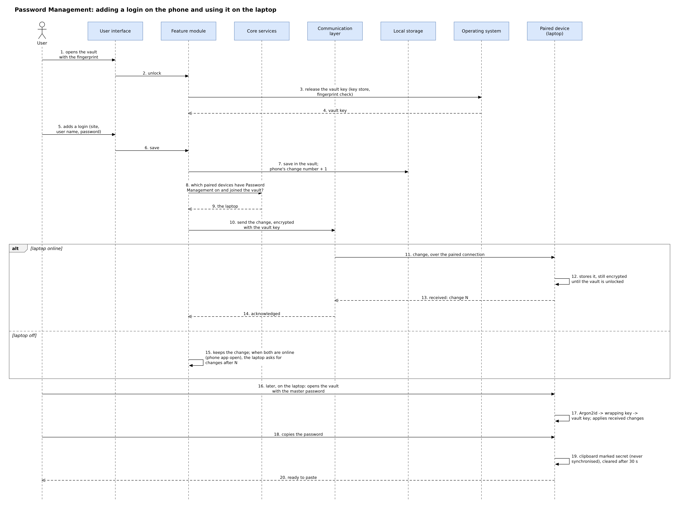

# Password Management

## Introduction

Most people have many online accounts and keep their passwords in a browser, in a notebook or in their memory. Password Management gives the user one password vault that is the same on all of their own devices. The user adds a login once, on any device, and it appears on the user's other paired devices without passing through any server or the internet. The vault is opened with one master password, or with a fingerprint or face on devices that support it. On Android, iPhone, iPad and Mac the user can let the system fill a saved password into other apps and websites. On the other systems the user copies the password, and the copy is cleared after a short time. This section describes what the vault holds, how it is protected, how it stays the same on all devices, how passwords are used in other apps, which risks remain, and how the design differs from an existing password manager.

## 1. What the vault holds and where the logins come from

- **Contents.** The vault holds logins (a name, the website or app, the user name, the password and a note) and secure notes. Payment cards, passkeys and one-time codes are not part of the first release.
- **Typing a login.** The user can type a login and use the built-in password generator.
- **Importing a file.** The user can import a CSV file that a browser or another password manager has exported. Chrome, for example, imports and exports CSV files whose first line names the columns `url`, `username` and `password`. Such a file is not protected, so after the import the app offers to delete it.
- **Reading browsers directly.** The app does not read the passwords that browsers store. On Windows, Chrome ties its stored secrets to Chrome itself (App-Bound Encryption, introduced in Chrome 127 for cookies), and Google has said that it may extend this protection to passwords. Other browsers and the browsers on phones keep their passwords in their own protected stores. Import from a file is therefore the recommended route.

## 2. How the vault is protected

**The three security rules of the system.** The main database is encrypted with a random key that is kept in the operating system's key store. The vault key is random and is stored only wrapped by a key made from the master password, so the master password can be changed. A device accepts a file list only if the owner device's signature is valid and its change number is higher than the one it already holds.

- **The vault file.** The vault is a separate SQLite file encrypted with SQLCipher.
- **The vault key.** When the vault is first set up, the app creates a random 256-bit vault key. SQLCipher receives it as a raw key, so SQLCipher does not apply its own key derivation.
- **The key made from the master password.** The master password is turned into a wrapping key with Argon2id, using 64 MiB of memory, 3 passes, 1 thread and a 16-byte random salt. These settings are above the minimum recommended by OWASP (19 MiB, 2 passes, 1 thread). They are not set above 64 MiB, because Bitwarden warns about higher values on iPhone and iPad.
- **What is stored.** The wrapping key encrypts the vault key with AES-256-GCM. Each device stores the wrapped vault key, the salt and the settings. The master password and the wrapping key are never stored. The plain vault key is stored only in the optional fingerprint or face copy described below.
- **Changing the master password.** A new master password only wraps the same vault key again. The vault itself does not need to be encrypted again.
- **Locking.** The vault locks when the app closes, when the screen locks, after 5 minutes without use (up to 30 minutes on computers, if the user chooses), and when the user taps "Lock". Locking removes the vault key from memory.
- **Fingerprint or face.** On each device the user may also keep a copy of the vault key in the operating system's key store, behind the fingerprint or face check. On iPhone, iPad and Mac this copy is a Keychain item that Apple invalidates when fingers are added or removed or Face ID is set up again. On Android it is a Keystore key behind the biometric check; checking with strong biometrics only is enforced from Android 11. On Windows and Linux the first release uses the master password only. The master password is asked again after every restart and every 14 days.
- **A forgotten master password.** There is no server, so the master password cannot be reset. If any device still opens the vault with a fingerprint or face, the user can set a new master password there, and the newly wrapped key is sent to the other devices. At setup the app also shows a recovery code of 128 random bits, which the user prints or writes down; this code also opens the vault. Without either of these, the vault cannot be opened. The setup screen says this plainly.

## 3. How the vault stays the same on all devices

- **Turning it on.** Password Management is off until the user turns it on, on each device. A device takes part only if it is a paired device, Password Management is turned on for it, and the user has typed the master password on it once. A new device receives the wrapped vault key and the salt from a paired device and opens it with the master password.
- **What is sent.** Each changed entry is encrypted with the vault key (AES-256-GCM) and sent over the encrypted connection between paired devices. The entry's id and version are bound to the encrypted data, so an old copy cannot be replayed as a new one. The vault therefore never leaves a device unencrypted.
- **Change numbers.** Every device numbers its own changes to the vault (1, 2, 3 and so on), because every device in the vault may edit it. Each entry keeps the latest number it has seen from each device. A device that was switched off asks each other device for the changes after the numbers it already holds.
- **Deleted entries.** A deleted entry becomes a deletion mark that is kept for 90 days. A device that was away for longer receives the whole vault again, so a deleted entry cannot come back.
- **The same entry changed on two devices.** If two changes to one entry were made without knowledge of each other, the later change becomes the current entry. The other change is kept in the entry's history, and the user sees "Edited on two devices; previous version saved". Nothing is lost, even if the clocks of the two devices differ.
- **Phones and tablets** exchange changes only while the app is open. A device whose vault is locked keeps received changes encrypted and applies them when the user unlocks the vault.

## 4. Using passwords in other apps and websites

| System | What the system allows an app to do | First release |
|---|---|---|
| Android 8 and later | An app can be the device's autofill service, chosen by the user in the system settings; it then fills logins in other apps. Chrome uses it only when the user chooses "Autofill using another service" in Chrome. | Autofill service, as a small native part of the app |
| iPhone and iPad 12 and later, macOS 11 and later | An app can add a Credential Provider extension to AutoFill (passwords, passkeys and one-time codes). It needs Apple's AutoFill entitlement. | AutoFill extension, as a small native part of the app |
| Windows | Since November 2025, password managers from other companies can plug into Windows for passkeys. No equivalent for passwords in any app was found. | Copy |
| Linux | No system autofill interface was found. | Copy |

**Copying a password.** A copied password is marked as secret, so Clipboard Synchronisation never sends it to another device. On iPhone and iPad it is marked "local only", so it is not passed to other Apple devices, and it expires after 30 seconds. On computers the app clears the clipboard after 30 seconds while it runs. On Android the app cannot clear the clipboard once it is in the background; it relies on the secret mark, and Android 13 and later clear the clipboard by themselves after a time. A browser extension is not part of the first release.

## 5. Risks and protection

| Risk | Protection | What remains |
|---|---|---|
| A lost device that is locked | The vault is encrypted; its key is stored only wrapped by the master password or behind the fingerprint or face check; the user removes the device and changes the vault key (Security and Privacy) | Offline guessing of a weak master password on the lost copy |
| A stolen device that is unlocked | The vault locks after 5 minutes and when the screen locks; showing or copying a password asks for the fingerprint or face again | What is on the screen before the vault locks |
| A paired device that misbehaves | Only devices that have joined the vault can read it; every change keeps a history; deletion marks are visible | A device that has joined can read every password; the user removes it and changes important passwords |
| Malware on a device | The vault is locked most of the time; phones keep the key behind the fingerprint or face check | Malware running as the user can read memory while the vault is open, or record the master password. On Windows the key store protects data from other user accounts, and, by inference, not from other programs of the same user |
| A copied vault file | It cannot be opened without the master password or the recovery code | Offline guessing, slowed by Argon2id |
| A weak master password | At least 12 characters and a strength meter; Argon2id | A guessable password remains guessable |
| A password left on the clipboard | The secret mark; it is never synchronised; it is cleared or expires (section 4) | Apps that read the clipboard before it is cleared, mainly on Windows and Linux |

## 6. Compared with Bitwarden

Like Bitwarden, the vault is encrypted on the device with a key that comes from the master password, and the master password is never sent anywhere. Unlike Bitwarden, there is no server: the user's devices exchange the vault directly on the local network, and nothing goes to a cloud. Limitation: there is no web vault and no browser extension, no account recovery or emergency access through a server, no sharing with other people, and a new device can join only while a paired device that holds the vault is online.

## 7. Adding a login on the phone and using it on the laptop

**Figure: adding a login on the phone and using it on the laptop.** Source file: `diagrams/C7-vault-sequence.drawio`.

The user opens the vault on the phone with the fingerprint, and the operating system's key store releases the vault key. The user adds a login, and the phone saves it in the vault with its next change number. The phone asks which paired devices have Password Management turned on and have joined the vault, and sends the change, encrypted with the vault key, to the laptop. If the laptop is online, it stores the change, still encrypted, and acknowledges it. If the laptop is off, the phone keeps the change until the laptop asks for it. Later the user opens the vault on the laptop with the master password. The laptop makes the wrapping key with Argon2id, unwraps the vault key and applies the received changes. The user copies the password, which is marked as secret and cleared after 30 seconds.

## 8. Requirements

- FR-PWD-1 The app must keep the vault in a separate SQLCipher file whose key is random and is stored only wrapped by a key made from the master password with Argon2id, or behind the fingerprint or face check in the operating system's key store.
- FR-PWD-2 The app must never store or send the master password or the wrapping key, and must never send the plain vault key.
- FR-PWD-3 The app must lock the vault when the app closes, when the screen locks and after 5 minutes without use.
- FR-PWD-4 The app must allow fingerprint or face unlocking only through the operating system's key store, and must ask for the master password after the device restarts.
- FR-PWD-5 The app must import logins from a CSV file and offer to delete the file afterwards.
- FR-PWD-6 The app must synchronise the vault only with paired devices that have joined the vault and have Password Management turned on.
- FR-PWD-7 The app must send vault changes only encrypted with the vault key, over the encrypted connection between paired devices.
- FR-PWD-8 The app must keep both versions when the same entry was changed on two devices.
- FR-PWD-9 The app must mark copied passwords as secret, must never synchronise them through Clipboard Synchronisation, and must clear them or let them expire after 30 seconds where the system allows.
- FR-PWD-10 The app must show the recovery code once at setup and must state that a forgotten master password cannot be reset.
- FR-PWD-11 The app must open the vault with the master password in about 1 second or less on the slowest supported phone.
- FR-PWD-12 The app must not send any vault data outside the local network.

## 9. Limitations

The following has not yet been verified: the time Argon2id takes on the team's phones and the Dart package that provides it; whether Dart clears the vault key from memory; AutoFill extensions built with Flutter; Windows Hello; whether the password stores of phone browsers can be read; and Universal Clipboard from a Mac. iPhone, iPad and macOS cannot be built or tested by the team, because no member has a Mac; the Apple parts of this design are checked against Apple's documentation only.

## 10. Summary

Password Management keeps one encrypted vault on all of the user's devices, without a server. A random vault key protects the vault, and a key made from the master password protects that key, so the master password can be changed and is never stored. Changes travel only between paired devices that have joined the vault, already encrypted, and no change is lost when two devices edit the same entry. Android, iPhone, iPad and Mac can fill passwords into other apps; on Windows and Linux the user copies them, and the copy is cleared.

## References (opened 8 November 2026)

1. OWASP, Password Storage Cheat Sheet (Argon2id minimum configurations): https://cheatsheetseries.owasp.org/cheatsheets/Password_Storage_Cheat_Sheet.html
2. Bitwarden, KDF algorithms (Argon2id defaults and the warning above 64 MiB on iOS): https://bitwarden.com/help/kdf-algorithms/
3. Zetetic, "Using random values as SQLCipher keys" (a raw key bypasses the key derivation): https://www.zetetic.net/blog/2019/06/07/technical-guidance-using-random-values-as-sqlcipher-keys/
4. Apple, `SecAccessControlCreateFlags.biometryCurrentSet`: https://developer.apple.com/documentation/security/secaccesscontrolcreateflags/biometrycurrentset
5. `flutter_secure_storage` package page (strong biometrics on Android; opened 21 October 2026): https://pub.dev/packages/flutter_secure_storage
6. Google, "Import or export passwords with Chrome": https://support.google.com/chrome/answer/13068232
7. Google Security Blog, "Improving the security of Chrome cookies on Windows", 30 July 2024: https://security.googleblog.com/2024/07/improving-security-of-chrome-cookies-on.html
8. Android Developers, "Build autofill services": https://developer.android.com/identity/autofill/autofill-services
9. Apple, `ASCredentialProviderViewController`: https://developer.apple.com/documentation/authenticationservices/ascredentialproviderviewcontroller
10. CyberInsider, "Windows 11 integrates native support for Bitwarden and 1Password", 12 November 2025: https://cyberinsider.com/windows-11-integrates-native-support-for-bitwarden-and-1password/
11. Apple, `UIPasteboard.OptionsKey` (`localOnly`, `expirationDate`): https://developer.apple.com/documentation/uikit/uipasteboard/optionskey
12. Team documents: Technology Choices (final); Security and Privacy; Clipboard Synchronisation; File Indexing and Offline-Device Records; Existing Systems (Bitwarden); Implementation and Evaluation Plan.
