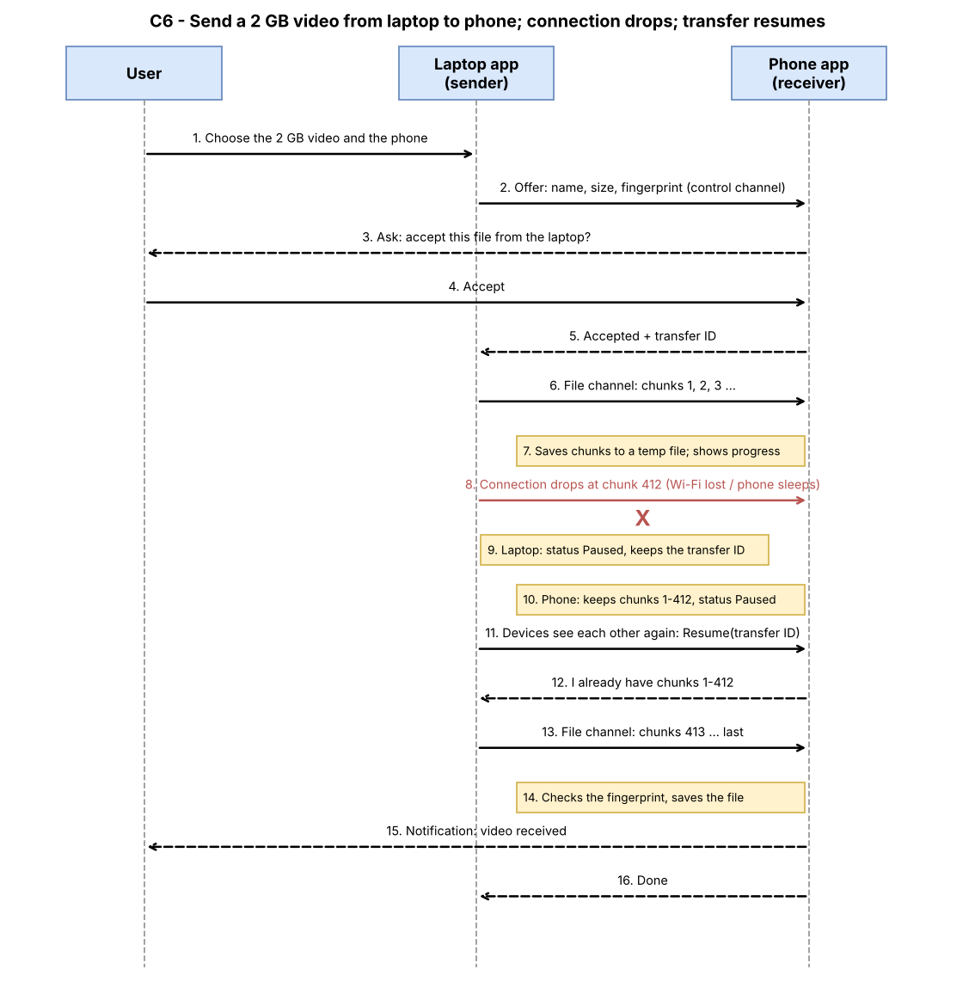

# C6 – Direct File Sharing (first version)

Owner: Samer. Status: first version, for review by Mahmoud and Ali (B6/B1).
Marks: **[PROPOSAL]** = my suggestion, to be agreed. **not checked** = I could not verify it yet.

## 1. What it is

Sending a file from one of the user's own devices to another over the local network, with no internet and no cloud. It is like LocalSend or AirDrop, but only between our own trusted (already paired) devices. Pairing and trust belong to C1; this design assumes both devices are already paired.

## 2. How it works – steps

**User side**
1. The user chooses a file (or several) and picks a target device from the list of paired devices.
2. If the target is online, the receiver shows "Device X wants to send *name* (size)" with Accept / Decline. **[PROPOSAL]** Transfers between two of the user's own paired devices are accepted automatically after the first time, if the user turns on "auto-accept from my devices" (default: off, so the user is asked each time).
3. Both devices show progress (percentage, size, speed estimate) with a Cancel button.
4. When done, the receiver shows "Received" with an Open / Show in folder action.

**App side**
1. The sender sends an *offer* on the control channel: file name, size, type and a fingerprint (hash) of the file, plus a transfer ID.
2. The receiver replies *accepted* or *declined*.
3. The file moves on a separate **file channel**, cut into chunks (B6 plans this; see section 6).
4. The receiver writes the chunks into a temporary file and, at the end, checks the fingerprint. Only if it matches, the file is moved to its final place.
5. Both sides record the result (done / failed / cancelled).

For comparison, the official LocalSend protocol also asks first and only then sends: the sender announces the files, the receiver can accept or reject (HTTP 403) or require a PIN (401), and either side can cancel the session. Source: https://github.com/localsend/protocol (opened 5 Nov 2026).

## 3. Large files and interruptions

**What "resuming" means [PROPOSAL].** The file is cut into chunks of a fixed size. The receiver keeps every chunk it has verified, and remembers the transfer ID. If the connection drops, nothing is deleted. When the devices see each other again, the sender asks "what do you already have?", the receiver answers with the chunks it holds, and the sender sends only the missing ones. The 2 GB file does not start from zero.

**What the user sees [PROPOSAL].**
- Connection drops (Wi-Fi lost, one device sleeps): status changes to "Paused – waiting for *Phone*" with the amount already sent. No error pop-up, no lost progress.
- When the device comes back: the transfer continues by itself and the status returns to "Sending".
- If the other device does not return within a limit (suggested: 24 hours), the transfer becomes "Failed – tap to retry". The temporary file is deleted after this limit to free storage.
- The user can always cancel; cancel deletes the temporary file on the receiver.

**Integrity.** The final fingerprint check protects against a corrupted file. If it does not match, the receiver deletes the temporary file and reports "Failed – file damaged, try again". Whether to verify each chunk separately is left to Ali (open point 2).

## 4. Switched-off devices, closed apps, same name

**Switched-off device or app closed [PROPOSAL rule].** The sender keeps a *waiting* transfer (a queue entry) for up to 24 hours. It shows as "Waiting for *Phone*". When the receiver appears on the network again, the normal offer/accept flow starts. We do **not** send the file to any server, so the file stays on the sender until then. A phone whose app is closed counts as offline, except where the system lets the app wake up for incoming connections (not checked on iOS or Android).

**Same name already exists on the receiver [PROPOSAL].** Never overwrite. The new file is saved as `name (1).ext`, `name (2).ext` and so on. If the receiver already has a file with the same fingerprint, the app tells the user "You already have this file" and does not store a second copy (this connects to duplicate detection, C4).

## 5. Limits per system

| System | Where a received file can be saved | Notes |
|---|---|---|
| Desktop (Windows, macOS, Linux) | Any folder; default: the user's Downloads folder | Normal file permissions apply. not checked per system. |
| Android phone | Downloads or a folder chosen by the user through the system file picker | Newer Android versions limit direct access to shared storage. not checked. |
| iPhone / iPad | Inside the app's own storage, with an option to export to the Files app or the Photos library through the share sheet | iOS apps are sandboxed, so the app cannot choose any folder by itself. not checked. |

Also not checked: whether a phone can receive a large file while the screen is off or the app is in the background (this differs strongly between iOS and Android and affects the "phone goes to sleep" case above).

## 6. Comparison with LocalSend and AirDrop (from A5)

| | LocalSend | Apple AirDrop | Our C6 |
|---|---|---|---|
| Devices | Any nearby device running LocalSend | Apple devices only | Only the user's own paired devices, all systems we support |
| Who can send | Anyone nearby (optional PIN) | Contacts Only or Everyone for 10 Minutes; from iOS 26.2 non-contacts must use an AirDrop code | Only paired, trusted devices |
| Asks the receiver | Yes (accept / reject) | Yes (accept / decline); no prompt when sending to yourself on the same Apple Account | Yes by default; optional auto-accept between own devices |
| Needs internet | No | Not for nearby devices; Apple says a transfer can continue over the internet if devices leave range | No, never (no cloud) |
| Resume after a drop | Not listed in the protocol page I read (not checked) | not checked | Yes, chunked and resumable **[PROPOSAL]** |
| Queue for offline devices | Not listed (not checked) | not checked | Yes, up to 24 h **[PROPOSAL]** |

**What we adopt:** ask before receiving; the offer-then-send order; cancel at any time (LocalSend); automatic acceptance between a person's own devices (AirDrop).
**What we do differently:** only trusted paired devices, so no strangers and no PIN or code step per transfer; no cloud fallback; resumable transfers and a waiting queue.
**What is not new:** sending a file between nearby devices. LocalSend and AirDrop already do this well. Our value is that it is one feature of a system that also knows the files on all devices (search, duplicates).

## 7. Diagram

Sequence diagram: sending a 2 GB video from the laptop to the phone, the connection drops, the transfer resumes.
Files: `diagrams/C6-file-sharing-sequence.drawio` and `diagrams/C6-file-sharing-sequence.png`

## 8. Requirements

- FS-1: The app must let the user choose one or more files and one paired device as the target.
- FS-2: The app must send only to devices that are paired and trusted (C1); it must refuse any other device.
- FS-3: The app must ask the receiving user to accept or decline an incoming file, unless the user turned on auto-accept for their own devices.
- FS-4: The app must show progress on both devices and let either user cancel at any time.
- FS-5: The app must send files over the local network only and must never upload them to a cloud or server.
- FS-6: The app must send files in chunks over a separate file channel, as B6 and B1 describe, so that large files do not block the control messages.
- FS-7: The app must keep the received chunks when the connection drops and resume with only the missing chunks when the devices reconnect.
- FS-8: The app must show "Paused" (not an error) while the other device is unreachable, and "Failed – tap to retry" after the waiting limit.
- FS-9: The app must check the fingerprint of the finished file and must not save a file that does not match.
- FS-10: The app must keep a transfer waiting for an offline device for a limited time (suggested 24 hours) and start it when the device returns.
- FS-11: The app must never overwrite an existing file; it must save the new one under a new name.
- FS-12: The app must tell the user when the receiver already has an identical file instead of storing a second copy.
- FS-13: The app must delete temporary files of cancelled or expired transfers.
- FS-14: The app must store received files in a location allowed by each operating system and must tell the user where the file is.

## 9. Open points and who settles them

1. **Ali (B6/B1):** Is the file channel really a separate chunked, resumable connection as B6 and B1 say (decision 10)? What chunk size and which library? I have written it as in B6 but have not read B6 final yet (not checked).
2. **Ali:** Fingerprint per chunk or only for the whole file?
3. **Mahmoud:** Is auto-accept between own devices allowed, and is "off by default" right?
4. **Mahmoud / team:** The waiting limit (24 hours) and what happens when the sender app is closed too.
5. **Mahmoud (C1) and Ahmed (C11):** Which security rules apply to the file channel (encryption, device identity)? This design assumes it is encrypted like the control channel.
6. **Mohammed (C4):** The "you already have this file" message needs the duplicate-detection fingerprint; use the same one?
7. **Whoever tests on devices later (phase 2):** the "not checked" items in section 5 (iOS and Android storage, background receiving).

## 10. Sources (opened 5 Nov 2026)

- LocalSend protocol v2: https://github.com/localsend/protocol
- LocalSend README: https://github.com/localsend/localsend/blob/main/README.md (from A5)
- Apple Support, "Use AirDrop to send items to nearby Apple devices": https://support.apple.com/en-ca/HT203106 and https://support.apple.com/en-us/ht5887
- Our A5 (six apps), on main.
